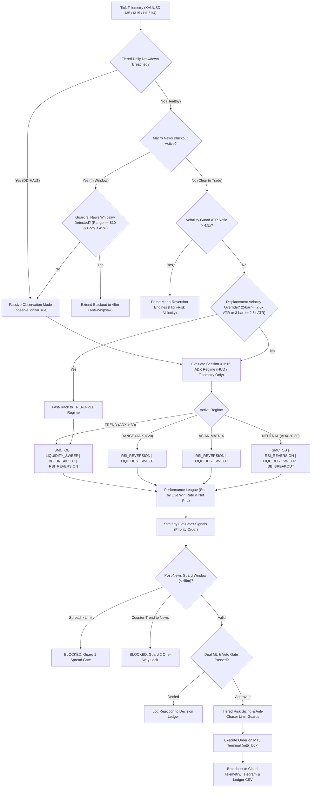
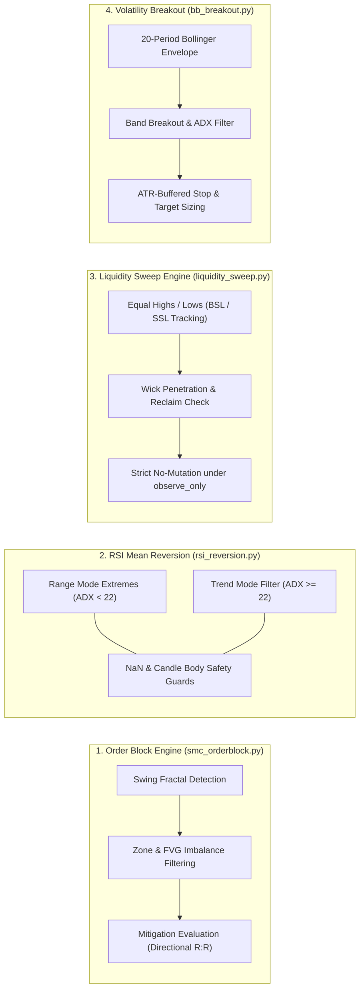
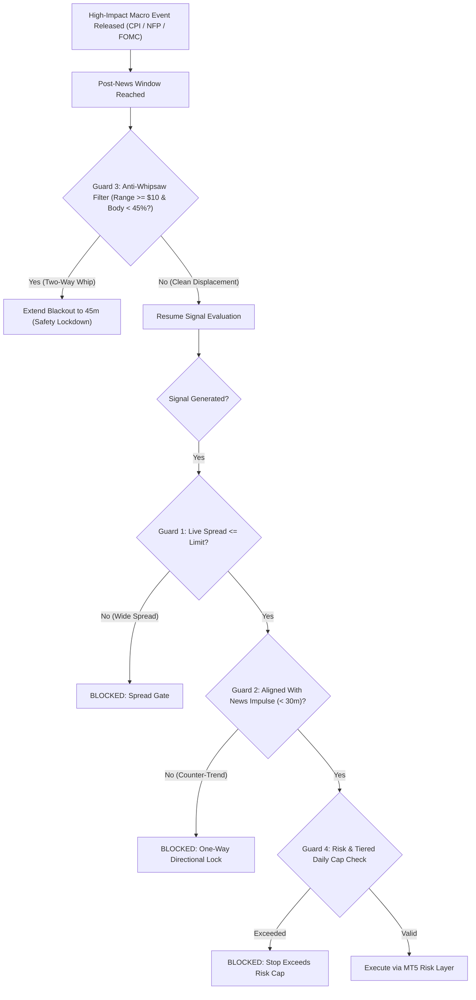
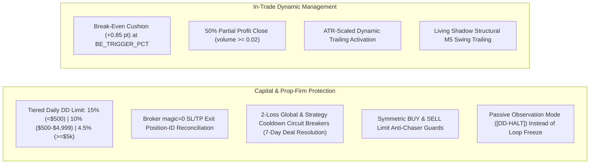

# Parallax — Quantitative Multi-Timeframe Execution & Risk Engine (`XAU/USD`)

[](https://www.python.org/downloads/)
[](https://www.metatrader5.com/)
[](https://scikit-learn.org/)
[](core/config.py)
[](tests/test_goldvx_drawdown_observation.py)

**Parallax** (built as the core execution engine of **NEXUS Quant Technologies**) is the **public, open-architecture release of a live production XAU/USD algorithmic trading platform that has been in continuous operation and development for over a year**.

Rather than publishing raw indicator scripts, this repository exposes the **institutional engineering layer** honed across live market regimes: deterministic multi-timeframe state synchronization (`M5 / M15 / H1 / H4`), passive market observation during drawdown/macro halts, 3-tier macroeconomic event blackouts, Purged & Embargoed cross-validation, tiered prop-firm drawdown circuit breakers, and thread-safe MetaTrader 5 IPC execution.

> **Public Architecture vs. Private Production Alpha Notice:**  
> All execution guardrails, risk mathematics, regime orchestrator (`src/goldvx.py`), ML feature schema, Purged-CV training pipeline (`src/auto_retrain.py`), and the 57-test automated suite are included here in full. To protect commercial IP of the live product, `strategies/` ships clean **Public Reference Adapters** while tuned production alpha strategies, client operational logs, and trained `.joblib` weights remain in the private production repository.

---

## System Architecture

Parallax continuously ingests tick and multi-timeframe OHLCV telemetry, validates daily drawdown and macroeconomic news gates, checks structural displacement velocity, ranks eligible engines dynamically by live performance, and serializes orders cleanly through `mt5_lock`.



---

## Market Regimes & Dynamic Orchestration

The core orchestrator ([`src/goldvx.py`](src/goldvx.py)) classifies market state every iteration across `M5`, `M15`, `H1`, and `H4`, routing execution priority across eligible engines:

| Regime State | Trigger Conditions | Active Engines | Operational Focus |
| :--- | :--- | :--- | :--- |
| **`[TREND]`** | `ADX > 30.0` or sustained HTF alignment | `SMC_OB`, `LIQUIDITY_SWEEP`, `BB_BREAKOUT`, `RSI_REVERSION` | Participates in directional expansions; mean-reversion switches cleanly to trend-pullback confirmation. |
| **`[TREND-VEL]`** | Displacement spike (`>= 2.0x ATR` over 2 bars or `>= 2.5x ATR` over 3 bars) | `SMC_OB`, `LIQUIDITY_SWEEP`, `BB_BREAKOUT` | Bypasses slow ADX lag during institutional displacement impulses. |
| **`[RANGE]`** | `ADX < 20.0` during London / New York | `RSI_REVERSION`, `LIQUIDITY_SWEEP` | Targets bounded range liquidity pools and statistical extremes. |
| **`[ASIAN-MATRIX]`** | Asian Session (`00:00 - 07:00 UTC`) | `RSI_REVERSION`, `LIQUIDITY_SWEEP` | Suppresses low-volume breakout chasing during Asia consolidation. |
| **`[ASIA-BREAKOUT]`** | Asian Session with volatility expansion / velocity | `SMC_OB`, `LIQUIDITY_SWEEP`, `RSI_REVERSION`, `BB_BREAKOUT` | Unlocks expansion engines if Asian volume breaks structure early. |
| **`[ROLLOVER]`** | Broker rollover window (`23:15 - 00:30 UTC`) | *Passive Observation (`observe_only=True`)* | Halts new exposure during illiquid spread widening while maintaining market visibility. |
| **`[DD-HALT]`** | Daily loss `>= Tiered Limit (15% / 10% / 4.5%)` | *Passive Observation (`observe_only=True`)* | Liquidates open exposure, locks execution until daily reset, and keeps live HUD/dashboard telemetry active. |

---

## Pluggable Strategy Adapter Architecture

The framework cleanly decouples execution orchestration from signal research behind [`strategies/base.py`](strategies/base.py), ensuring every signal engine honors `observe_only=True` and passes immutable structural payloads downstream:



*(Note: Files in `strategies/` contain clean **Public Reference Adapters** demonstrating interfaces and `observe_only` safety guarantees; proprietary production alpha parameters are withheld.)*

---

## Tiered Macro News Filter & Post-News Safety Guards

Trading unguarded across Tier-1 releases (`CPI`, `NFP`, `FOMC`) exposes accounts to extreme spread widening and whipsaw slippage. [`engine/news_filter.py`](engine/news_filter.py) implements a 3-tier economic calendar blackout coupled with 4 post-news re-engagement gates:

- **Tier 1 (`USD-HIGH`):** `CPI`, `NFP`, `PPI`, `PCE`, `FOMC`, `GDP`, `Retail Sales` — `15m` pre / `15m` post blackout.
- **Tier 2 (`USD-SPEECH`):** Federal Reserve speeches & testimonies — `10m` pre / `15m` post blackout.
- **Tier 3 (`NON-USD-HIGH`):** Major `EUR`, `GBP`, `JPY`, `NZD`, `AUD`, `CAD` red-folder events — `10m` pre / `10m` post blackout.



---

## Tiered Risk Management & Execution Safeguards

Capital protection and in-trade execution management live in [`core/config.py`](core/config.py), [`core/performance_tracker.py`](core/performance_tracker.py), and [`engine/mt5_interface.py`](engine/mt5_interface.py):



---

## Machine Learning & Purged Walk-Forward Validation

- **21-Dimensional Multi-Timeframe Features ([`engine/feature_extractor_v3.py`](engine/feature_extractor_v3.py)):** Computes normalized stationary features across `M5`, `H1`, and `H4` (EMA distance ratios, ATR volatility ratios, M15 ADX state, RSI dynamics, and candle wick/body microstructure).
- **Purged & Embargoed Cross-Validation ([`src/auto_retrain.py`](src/auto_retrain.py)):** Implements temporal fold splitting with explicit purge and embargo intervals between training and validation folds (López de Prado methodology) to prevent overlapping-horizon label leakage.
- **Live Feedback Veto Trainer ([`src/evolve.py`](src/evolve.py)):** Retrains a linear meta-veto filter from closed live MT5 executions once sufficient two-class sample volume (`>= 80` trades) has accumulated.

---

## Repository Structure

```text
parallax/
├── core/
│   ├── config.py                # Tiered drawdown thresholds, session schedules, risk params (.env-driven)
│   ├── indicators.py            # ATR, ADX, RSI, VWAP, and Volume-at-Price (POC) calculations
│   ├── license_manager.py       # Session verification helper
│   ├── performance_tracker.py   # Live league ranking & 7-day-resolved 2-loss cooldowns
│   ├── state_manager.py         # Atomic file-locked JSON persistence (portalocker)
│   └── utils.py                 # Broker DST & UTC session clock alignment
├── engine/
│   ├── mt5_interface.py         # Thread-safe MT5 IPC (mt5_lock), sizing, DD halt, Living Shadow SL
│   ├── feature_extractor_v3.py  # 21-feature multi-timeframe ML feature builder
│   ├── news_filter.py           # ForexFactory 3-tier macro blackout engine + stale cache fallback
│   ├── copier.py                # Lock-guarded local JSONL trade copier queue
│   ├── supabase_pusher.py       # Thread-safe cloud telemetry & open-order reconciliation
│   ├── telegram_notifier.py     # Bot commands (/status, /today, /kill, /pause) & channel alerts
│   └── trade_logger.py          # Automated monthly ledger & drawdown analytics exporter
├── src/
│   ├── goldvx.py                # Main orchestrator loop, regime router & passive observation mode
│   ├── auto_retrain.py          # Purged & embargoed walk-forward ML training pipeline
│   ├── evolve.py                # Live feedback veto trainer
│   └── backtester.py            # Vectorized historical replay harness
├── strategies/                  # Pluggable BaseStrategy SDK & Public Reference Adapters
├── tests/
│   └── test_goldvx_drawdown_observation.py  # 57 automated tests covering halts, tiers & edge cases
├── .env.example
├── .gitignore
├── pyproject.toml
└── requirements.txt
```

---

## Setup & Verification

The automated test suite mocks MetaTrader 5 IPC and runs completely offline on Windows, macOS, or Linux:

```bash
# 1. Install dependencies
pip install -r requirements.txt

# 2. Configure environment variables (only required for live broker/cloud runs)
cp .env.example .env

# 3. Run the 57-test verification suite
python -m pytest tests/ -v
```
